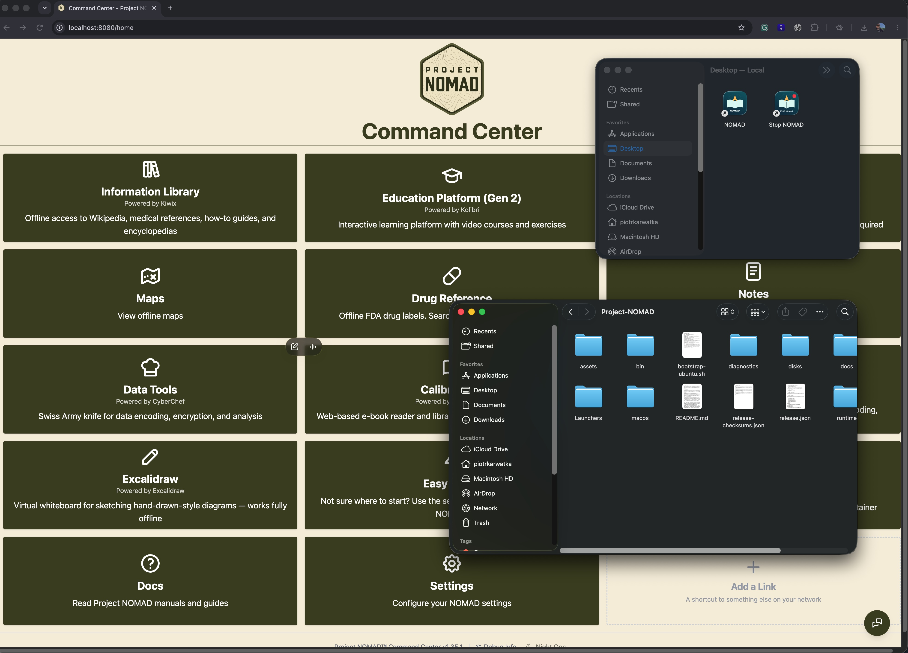

# 🧭 Project NOMAD on MacosX

### Your offline knowledge library. On your Mac. No external drive required. 🍎

Run [Project NOMAD](https://github.com/Crosstalk-Solutions/project-nomad) in an Ubuntu microVM powered by [microsandbox](https://github.com/superradcompany/microsandbox), with native macOS Start/Stop apps and optional host-native Ollama for Apple GPU inference.

**Community prototype · Apple Silicon · macOS · Tested with microsandbox 0.7.13**

- ✅ Internal SSD or external storage
- ✅ Everything in one `~/Project-NOMAD` folder, with Desktop shortcuts
- ✅ Docker runs inside Ubuntu; Docker Desktop is not required
- ✅ Existing library, settings and databases survive relocation
- ✅ Browser dashboard at **http://localhost:8080**

> This repository contains the installer and runtime adapter. Your chosen knowledge library and AI models are downloaded separately before offline use.



## 🚀 Install with one command

```bash
curl -fsSL https://raw.githubusercontent.com/pkarw/project-nomad-on-macosx/main/install.sh | sh
```

The installer checks your Mac and free space, installs microsandbox through Homebrew when needed, downloads the adapter, prepares clean Linux disk images, builds the native apps, adds Desktop shortcuts and starts NOMAD. Everything stays in `~/Project-NOMAD`; the installer refuses to overwrite an existing installation or Desktop shortcuts.

**Requirements:** Apple Silicon, Homebrew, Apple Command Line Tools and at least **400 GiB free**. If Command Line Tools are missing, it opens Apple's installer; finish that installation and rerun the command. The first NOMAD startup downloads and builds its services and can take several minutes or longer. Later launches use the Desktop shortcut.

Install without starting the services:

```bash
curl -fsSL https://raw.githubusercontent.com/pkarw/project-nomad-on-macosx/main/install.sh | sh -s -- --no-start
```

Check prerequisites without making changes:

```bash
curl -fsSL https://raw.githubusercontent.com/pkarw/project-nomad-on-macosx/main/install.sh | sh -s -- --check
```

### 📂 Install into a different directory

Pass `--dir` followed by an absolute path. For example, install into `~/Project-Nomad-2` and start automatically:

```bash
curl -fsSL https://raw.githubusercontent.com/pkarw/project-nomad-on-macosx/main/install.sh | sh -s -- --dir "$HOME/Project-Nomad-2"
```

If you already have an installation and want to prepare a test copy without starting it, add `--no-start`:

```bash
curl -fsSL https://raw.githubusercontent.com/pkarw/project-nomad-on-macosx/main/install.sh | sh -s -- --dir "$HOME/Project-Nomad-2" --no-start
```

This creates separate disk images and Desktop shortcuts named **NOMAD (Project-Nomad-2)** and **Stop NOMAD (Project-Nomad-2)**. Existing installations and shortcuts are preserved. Omit `--no-start` to start automatically after installation.

**One installation can run at a time:** each fresh installation has its own sandbox identity, but they share the dashboard port. Stop the current installation before starting the test copy. Existing installations keep their original runtime identity. These options do not enable simultaneous use of the same dashboard port.

`--dir=PATH` and the existing `NOMAD_INSTALL_DIR` environment variable are also supported; `--dir` takes precedence. Paths must be absolute; use `"$HOME/..."` to select a folder in your home directory.

After setup, double-click the Desktop **NOMAD** shortcut for your installation (for example, **NOMAD (Project-Nomad-2)**). Use its matching **Stop NOMAD** shortcut when finished. The dashboard opens at **http://localhost:8080**. Optional AI requires installing [Ollama](https://ollama.com) and downloading a model on your Mac.

## 🧠 How it works

```text
macOS / Apple Silicon
├── NOMAD.app → Go launcher → microsandbox → Ubuntu 24.04
│                                          └── Docker → NOMAD + apps
├── ~/Project-NOMAD/disks/nomad-data.img     ← library, settings, databases
├── ~/Project-NOMAD/disks/docker-arm64.img   ← Docker images/cache
└── native Ollama                           ← optional Apple GPU inference
```

The guest sees real ext4 filesystems inside raw disk-image files. macOS stores those files on its internal disk or an external drive. Host runtime metadata lives in `~/.microsandbox-nomad`; downloaded Ollama models remain in Ollama’s own storage.

## 📦 Requirements

- Apple Silicon Mac (M1 or newer); Intel Macs are untested here.
- Enough RAM for the launcher’s **8 GiB Ubuntu guest**, plus macOS and optional AI models.
- **At least 400 GiB free for the default workspace**, plus temporary builder space for a fresh install. Content disk: 256 GiB; per-architecture Docker cache: 64 GiB; clean Docker seed: 8 GiB. Allow extra room for VM state and downloads.
- Internet for the initial runtime, images, builds, models and knowledge downloads. Offline use requires downloading your chosen content first.
- [Homebrew](https://brew.sh), Python 3, and Apple Command Line Tools (`xcode-select --install`).

The installer installs microsandbox when needed using Homebrew. See its [official installation instructions](https://github.com/superradcompany/microsandbox#readme) for details. The tested version is **0.7.13**; newer versions may change CLI behavior.

## 🤖 Native AI on your Mac

The adapter reuses host-native Ollama so inference can use Apple’s GPU. It connects through NOMAD’s existing remote-Ollama feature at:

```text
http://host.microsandbox.internal:11434
```

Existing AI configuration is preserved. Run Ollama and download your model on the host first. The adapter does not move your models into the VM or stop Ollama when NOMAD stops.

## 🛑 Stop, back up, move

- **Stop:** use the Desktop **Stop NOMAD** shortcut; wait for completion.
- **Backup:** while stopped, copy `disks/nomad-data.img` to another physical disk and verify its checksum. Keep the compatible adapter version too. Back up host Ollama models separately if needed.
- **Move:** stop → copy → verify → start. Never run two writers against the same images.
- **Grow:** after a verified backup, `./bin/darwin-arm64/nomad grow 512` enlarges the content disk to 512 GiB. Shrinking is unsupported.

## 🔧 Troubleshooting

| Symptom | Next step |
| --- | --- |
| Dashboard unavailable | Wait for first-build completion; inspect `~/.microsandbox-nomad/gui-start.log` and `launch.log`. |
| Port 8080 is busy | Stop the other service before launching NOMAD. |
| Session belongs to another host | Stop NOMAD on that host; do not delete the marker while any writer might exist. |
| Apps cannot find the workspace | Keep both apps in `Launchers/` and its `Project-NOMAD -> ..` link intact. |
| AI has no models | Start host Ollama, download a model and check the remote endpoint in AI settings. |
| An update changes behavior | This prototype pins NOMAD source and disables automatic core updater startup. Update the adapter deliberately. |

## 🧪 Tested scope

The working deployment used **NOMAD 1.35.1**, revision `54ee30a44902e5c252b477f8685c26ec3064ab72`, **Ubuntu 24.04** and **microsandbox 0.7.13**. Internal-SSD relocation and dashboard health were checked on Apple Silicon. Startup timing varies; the first install is not instant. Other platforms are not claimed as validated here.

See [validation](docs/VALIDATION.md), [original reproduction notes](docs/REPRODUCE.md) and [release metadata](release.json).

## 🙌 Credits & license

Built around [Project NOMAD by Crosstalk Solutions](https://github.com/Crosstalk-Solutions/project-nomad) and [microsandbox](https://github.com/superradcompany/microsandbox), both Apache-2.0 projects. This is an independent community adapter, not an official macOS release. Adapter code is MIT licensed; upstream projects retain their own licenses. No personal library, credentials, models, database images or runtime archives are included.
